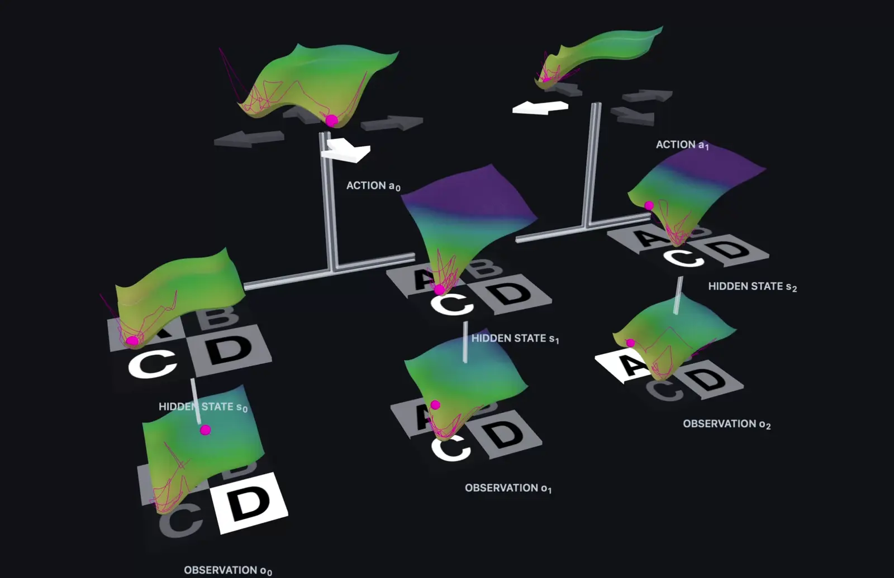

# Thermodynamic Reasoning – p-bit POMDP

**Live demo: https://glawleschkoff.github.io/thermodynamic-reasoning/**

Sixteen coupled p-bits governed by double-well Langevin dynamics encode a POMDP (three hidden states, three observations, and two actions), realizing perception, planning, and action via thermal relaxation. The interactive 3D viewer visualizes the trajectories across continuous energy surfaces alongside empirical state distributions and exact analytical Bayesian posteriors.

## Structure
- `model.py` – the physics: double-well potential, coupling matrix J (sensor and transition models), energy V
- `simulate.py` – the dynamics: Euler-Maruyama steps of the Langevin equation (JAX), with clamping from outside
- `pipeline/` – everything around them: ensemble check, exact Bayes reference, data export, dev server, notebook
- `docs/` – the browser viewer (also served by GitHub Pages)

## Usage
    pip install -r requirements.txt
    python3 -m pipeline.run   # simulation -> docs/data.js
    python3 -m pipeline.dev   # http://localhost:8000

## Demo
The viewer is static. On GitHub Pages choose "Deploy from a branch", branch `main`, folder `/docs`.
`docs/data.js` is part of the repository, so no Python is needed to view the demo.

## Credits and licenses
- Code: MIT, see `LICENSE`.
- Bee model: "Cube Pets" by Kenney (kenney.nl), CC0.
- Honeycomb model: "Honeycomb" by Poly by Google [CC-BY]
  (https://creativecommons.org/licenses/by/3.0/) via Poly Pizza (https://poly.pizza/m/6Mqdrv1n3Oo).
  Used unchanged except for scaling, rotation and placement.
- three.js (MIT), included in `docs/vendor`.
